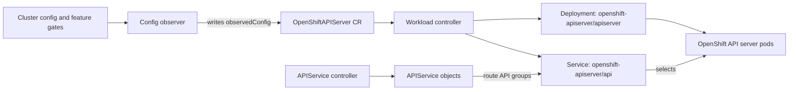

# Architecture

## Overview

The cluster-openshift-apiserver-operator manages the OpenShift API Server for OpenShift clusters. It runs in the `openshift-apiserver-operator` namespace and reconciles a cluster-scoped `OpenShiftAPIServer` custom resource named `cluster`.

The `OpenShiftAPIServer` custom resource is the operator's configuration and status object. It is not the running API server process. The operand is the OpenShift API server workload that the operator deploys and manages from that object.

The operator's startup is organized in `pkg/operator/starter.go`. It prepares a controller set that handles:

- operand workload reconciliation
- configuration observation
- APIService registration
- static operand resources
- audit and encryption revisions
- encryption key management
- operator status
- network connectivity checks

The operator reports status through the `openshift-apiserver` `ClusterOperator` resource.



## Operand

The operator manages a single operand: the OpenShift API Server.

It runs in the `openshift-apiserver` namespace and consists of:

- a `Deployment` for the API server pods
- a `ConfigMap` holding the merged API server configuration
- a `Service` and `ServiceAccount`
- network policies
- an optional `PodDisruptionBudget` on multi-node clusters

The operator registers `APIService` objects for these API groups and routes them to the operand's `api` Service:

- `apps.openshift.io`
- `authorization.openshift.io`
- `build.openshift.io`
- `image.openshift.io`
- `project.openshift.io`
- `quota.openshift.io`
- `route.openshift.io`
- `security.openshift.io`
- `template.openshift.io`

The Build and DeploymentConfig API groups are omitted when their corresponding cluster capabilities are disabled.

## Operator Startup Flow

```text
cmd/cluster-openshift-apiserver-operator/main.go
  → operator.NewOperator()
    → operator.RunOperator()          [pkg/operator/starter.go]
      → build clients and informers
      → assemble the APIServer controller set
      → start config observer
      → start resource sync
      → start connectivity checks
      → start stale-condition cleanup
```

All controllers use the library-go factory pattern. They are synced once at startup and then run continuously with informer-driven requeues.

## Controllers

| Controller | Location | Purpose |
|---|---|---|
| Workload | `pkg/operator/workload` | Merges operand config and reconciles the API server `Deployment` |
| Config observer | `pkg/operator/configobservation` | Watches cluster config and writes `spec.observedConfig` |
| APIService | `pkg/operator/starter.go` | Registers OpenShift API groups and respects cluster capabilities |
| Static resources | `pkg/operator/starter.go` | Applies namespace, service, RBAC, network policy, and optional PDB |
| Revision and audit | `pkg/operator/starter.go` | Manages audit policy and encryption-config revisions |
| Encryption | `pkg/operator/starter.go` | Handles encryption config, key rotation, migration, and KMS preflight |
| Resource sync | `pkg/operator/resourcesynccontroller` | Copies etcd CA and client secret into the operand namespace |
| Connectivity check | `pkg/operator/connectivitycheckcontroller` | Creates `PodNetworkConnectivityCheck` resources |
| Namespace finalizer | `pkg/operator/nsfinalizercontroller` | Clears the operand namespace finalizer after workload removal |
| Status and stale conditions | `pkg/operator/starter.go` | Maintains `ClusterOperator` status and removes obsolete conditions |

## Config Observers

Located in `pkg/operator/configobservation`.

| Observer | What it observes |
|---|---|
| Images | Registry and image-policy settings |
| Ingress | Routing domain |
| Projects | Project request defaults |
| Proxy | Proxy configuration |
| etcd | Storage URLs and CA/secret sync |
| APIServer | TLS security profile |
| Encryption | Encryption configuration |
| Feature gates | Feature-gate-derived API server arguments |

## Feature Gates

Feature gate state is initialized in `pkg/operator/starter.go` from the `ClusterVersion` and `FeatureGate` resources. The operator waits for the initial feature gate observation before starting reconciliation. If the observed feature gate set changes after startup, the operator process exits so it can restart with the new gate set.

Feature gates affect this operator in three main ways:

- The config observer renders known feature gates and their enabled or disabled values into `apiServerArguments.feature-gates` in `OpenShiftAPIServer.spec.observedConfig`.
- `KMSEncryption` controls whether KMS plugin sidecars are injected into the operand `Deployment`.
- `WatchList` is force-disabled in the config observer because the `Project` API does not support it.

## Namespaces

| Namespace | Role |
|---|---|
| `openshift-apiserver-operator` | Operator |
| `openshift-apiserver` | Operand |
| `openshift-config` | User-specified configuration |
| `openshift-config-managed` | Machine-managed configuration |

## Key Directories

```text
cmd/cluster-openshift-apiserver-operator/   Operator entrypoint
pkg/operator/
  starter.go                                Controller registration and startup
  workload/                                 Operand workload controller
  configobservation/                        Config observers
  resourcesynccontroller/                   Shared resource sync
  connectivitycheckcontroller/              Network connectivity checks
  nsfinalizercontroller/                    Namespace finalizer
bindata/v3.11.0/                            Operand manifests and default config
manifests/                                  Operator deployment, RBAC, monitoring
test/
  e2e/                                      General e2e tests
  e2e-encryption/                           Encryption e2e tests
  e2e-encryption-rotation/                  Encryption rotation e2e tests
  e2e-encryption-kms/                       KMS encryption e2e tests
  extended/                                 OpenShift tests extension suite
```
